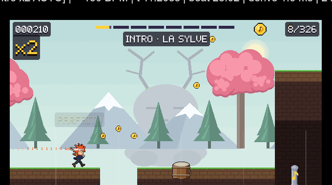
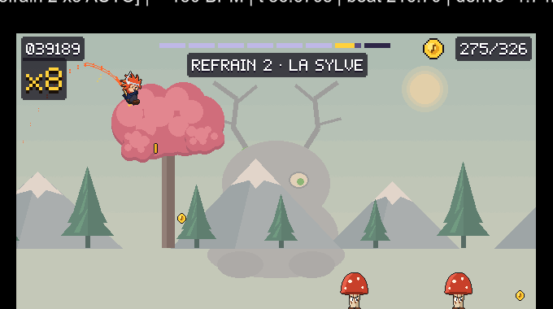
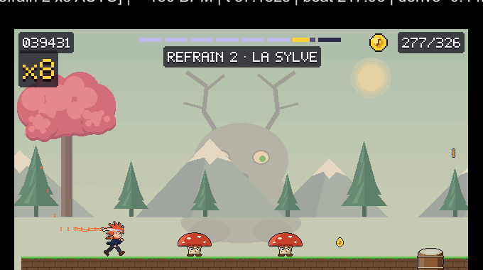

# Audit visuel et ressenti — 2026-11-25

**État (2026-11-25, branche `feat/audit-visuel`)** : P0, P1 et P2 faits, verticalité comprise (à la demande de Jeremy, sans toucher à la physique de `PlayerController`). Gardien : gardé entier et **devant** les montagnes (choix de Jeremy : c'est l'élément principal du décor). Reste à tester sur la vraie borne.

Objectif : une partie **belle et propre**. Ce document liste ce qui abîme l'expérience aujourd'hui, avec la cause dans le code et une piste de correction. Les points à faire sont repris dans la [roadmap](roadmap.md#audit-du-2026-11-25).

## Méthode
- Partie complète du niveau 01 (La Sylve) en **autoplay** dans l'éditeur, une capture toutes les 0,25 s (784 images), puis retour à l'accueil (logo, démo, classement).
- Résultat de la partie : niveau fini, note S, 326/326 pièces, 142 PARFAIT. Pas de mort : le gameplay de l'autoplay est sain.
- ⚠️ Captures prises dans une Game view « Free Aspect » de 980 × 522 px : l'agrandissement n'est pas entier, donc les pixels ne sont pas nets sur les images. Ça ne change rien aux défauts décrits ici (positions, superpositions), mais **les détails de pixel art sont à revoir en 1920×1080**.
- **Pas couvert à l'audit, revu ensuite en 1920×1080** (outil local `AuditScenarios`) : accueil, consignes, choix du héros et du monde, les 8 mondes en partie (décor posé sur le sol partout), mort → GAME OVER → saisie du nom (NOUVEAU RECORD, minuteur, retour à l'accueil) → classement. En éditeur, le score saisi n'est envoyé nulle part (pas de borne locale) : le classement reste vide, c'est normal.
- **Toujours pas couvert** : la vraie borne (Firefox ESR, 60 fps, manettes, envoi du score).
- ⚠️ Piège d'outil : une capture d'écran fige l'éditeur ~100 ms ; avec une capture par seconde, l'autoplay rate le saut au pied de la première grande rampe (beat ~48) et meurt. Sans captures, le niveau est fini. Ce n'est pas un bug du jeu.

## P0 — ce qui casse l'image en jouant

### 1. Le décor est collé à l'écran verticalement : les arbres « volent »
| Arbres au-dessus du vide | Héros au-dessus des arbres | Vide pâle sous les arbres |
|---|---|---|
|  |  |  |

- **Ce qu'on voit.** Le niveau monte et descend beaucoup (sol de −60 à 60 u, ADR-018), et la caméra suit. Le décor, lui, ne bouge pas verticalement. Résultat : sapins, arbre rose et montagnes restent à la même hauteur d'écran pendant que le sol du niveau passe au-dessus ou en dessous d'eux. Les arbres se retrouvent plantés dans le vide au-dessus des trous, le héros saute plus haut que leur cime, et ils semblent glisser quand la caméra monte.
- **Cause.** `FX/BiomeBackdrop.LateUpdate` place les trois calques à `y = c.y`, la hauteur de la caméra : parallaxe horizontale (0,12 / 0,35 / 0,7), mais aucune verticale. Le ciel et le gardien sont aussi à `c.y`, ce qui est normal pour le ciel mais pas pour le reste.
- **Correction proposée.**
  1. **Parallaxe verticale** pour chaque calque, ancrée à une ligne d'horizon du monde : `y = horizon + (c.y − horizon) × (1 − p)`, avec `p` proche de la parallaxe horizontale (par exemple 0,1 / 0,3 / 0,55). Le loin bouge à peine, le proche suit presque le niveau.
  2. **Horizon** : la hauteur du sol lissée sous la caméra. Le rail de caméra la donne déjà (`CameraRig.Rail`), sinon `LevelTerrain` au x de la caméra, lissé sur environ 2 temps pour ne pas sauter à chaque marche.
  3. Vérifier en partie que le pied du calque proche ne remonte jamais au-dessus du sol du niveau dans les grandes montées.

### 2. Une bande vide et pâle sous la ligne des arbres
- **Ce qu'on voit.** Quand le sol du niveau est bas dans l'image (descentes, chutes), on voit sous les arbres du décor une grande zone pâle (troisième capture) : le bas des calques est vide, et on voit à travers la brume.
- **Cause.** Les PNG des calques (`tools/kenta_art.py`) s'arrêtent à leur ligne de sol. Avec le point 1, ce vide devient visible dès que la caméra descend.
- **Correction proposée.** Dessiner un **pied** à chaque calque : sous-bois et terre du biome, qui fonce vers le bas, assez haut pour couvrir toute la hauteur de la vue. Ou poser sous chaque calque un aplat de sa couleur la plus sombre, qui suit le calque. À faire en même temps que le point 1.

### 3. Le gardien occupe le centre de l'image
- **Ce qu'on voit.** Une statue grise translucide et floue, d'environ un tiers de l'écran, au milieu, juste derrière l'action. Ses yeux s'allument à chaque section. Elle attire l'œil plus que les obstacles, et l'effet « fantôme » fait sale.
- **Cause.** `BiomeBackdrop` la place au centre de la caméra (`c + guardianOffset`), collée à l'écran, sous la brume.
- **Correction proposée.** La reculer dans la profondeur : plus petite, sur le côté ou en partie cachée par les montagnes, opaque mais dans les tons du ciel lointain, avec une parallaxe très faible plutôt que collée à l'écran. Garder l'éveil des yeux pour les drops seulement.

## P1 — propreté et lisibilité

4. **Brume blanche sur tout le décor** (`fog` à 32 % d'opacité, `BiomeBackdrop`) : l'image est délavée et le contraste du décor baisse partout, ciel compris. Piste : une brume plus forte en bas et au loin qu'en haut, ou désaturer directement les PNG des calques lointains et réduire la brume à environ 15 %.
5. **« PARFAIT ! » reste en arrière** : le mot est posé là où l'action a été jugée (`UI/JudgePopup.Show`, ancre fixe dans le monde). Il traîne derrière le héros qui court, passe parfois sous lui, et un « PARFAIT » gris fantôme reste visible pendant le fondu. Le faire suivre le héros (décalage fixe au-dessus de lui), en fondu plus court. Remonte le point P2 existant.
6. **Traînée du bandeau en pointillés orange** (`FX/BandanaTrail`) : bruit visuel, surtout en saut (courbes de points). Depuis ADR-022, le bandeau des héros flotte déjà vraiment. Piste : supprimer la traînée, ou la refaire en ruban continu de la couleur du bandeau qui n'apparaît qu'à partir de ×4.
7. **Pièces trop petites** et parfois au bord ou hors de l'image en haut lors des montées. Les agrandir (au moins 10 px en vue 640) et garder les arcs de pièces dans la marge de sécurité de la caméra.
8. **Cadrage aux extrêmes** : sur certains tambours et chutes, le héros frôle le haut de l'image, ou le sol est collé au bas avec un grand vide au-dessus. Revoir `safeMargins` et la contrainte du rail (`gen-level-vertical.py`) pour que héros **et** sol restent dans la zone centrale.
9. **Piliers de terre** encore très massifs et sombres : ils occupent jusqu'à la moitié de l'écran sur les marches hautes. Piste : limiter leur hauteur visible, avec un dégradé vers la couleur de fond du biome plutôt que du brun sur toute la hauteur.

## P2 — finitions
10. *(fait : titre en haut, note ×4 centrée, panneau en dessous)* **Écran « BRAVO ! »** : la lettre de note (S) est coincée dans une case étroite collée au panneau, et le feu d'artifice reste petit (point P2 existant). Donner de la place à la note (grande, centrée au-dessus du panneau) et un vrai bouquet.
11. *(fait : l'étiquette ne reste que 3 s après chaque changement de section)* **HUD** : l'étiquette de section (« COUPLET · LA SYLVE ») peut chevaucher des pièces en haut de l'image. Lui donner une plaque, ou la masquer après 2 temps.
12. *(fait : 5 motifs dans le calque proche, grand arbre, buissons, petit arbre)* **Arbre rose du décor** dessiné plus gros que tout le reste : il revient très souvent et finit par se répéter. Varier les éléments du calque proche (au moins 3 motifs par biome).

## Verticalité (fait le 2026-11-25, à la demande de Jeremy)
13. **Le héros glisse en montée et en descente.** En montant une colonne de marches ou une rampe, ses pieds suivent le terrain (`PlayerController` : le sol au contact remplace sa hauteur) pendant que l'animation de course continue à plat : il « glisse » vers le haut. En descente, il tombe du bord sans transition. Pistes : une pose d'appui ou d'escalade sur chaque marche montée, une réception à chaque marche descendue, une course inclinée sur les rampes.

**Fait** : `HeroAnimator` lit la pente et la distance parcourue sur la position du héros (rien n'est changé à sa physique) : cycle de **montée** penché en avant (`climb_0..7`), cycle de **descente** penché en arrière (`descend_0..7`), **chute** depuis un bord (un pas dans le vide puis bras levés, `fall_0..2`), course calée sur la distance le long du sol. Cadrage : `CameraRig.safeMargins` (0,12 en bas, 0,2 en haut) garde la tête et les arcs de pièces sous le HUD en montée. Piliers : `fill_deep` éclairci vers la couleur du ciel du biome.

## Déjà dans la roadmap et confirmé par l'audit
Pièces qui tournent en traits parasites, plateformes trop fines, tambours peu lisibles, héros petit en vue 640, frise du HUD à 8 segments, « SILENCE… » au milieu de l'écran à la mort.

## Ordre conseillé
1. **Décor** : points 1, 2 et 3 ensemble, car ils touchent tous `BiomeBackdrop` et `kenta_art.py`. Une fois faits, rejouer la partie en autoplay et refaire les captures pour comparer.
2. Points 4 à 6 : réglages rapides, gros gain de propreté.
3. Points 7 à 9 : chart et caméra (`gen-level-vertical.py`), à valider avec le simulateur.
4. Finitions P2, puis **test sur la borne** (1920×1080, Firefox, à 2 m).
