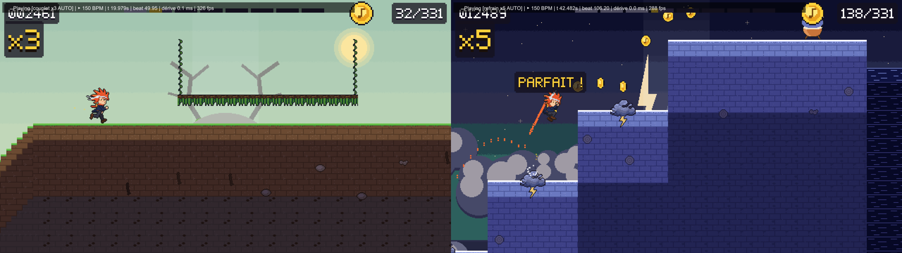
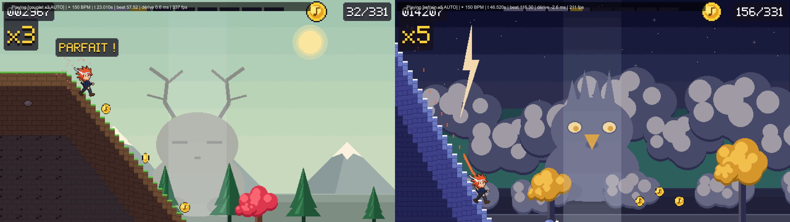
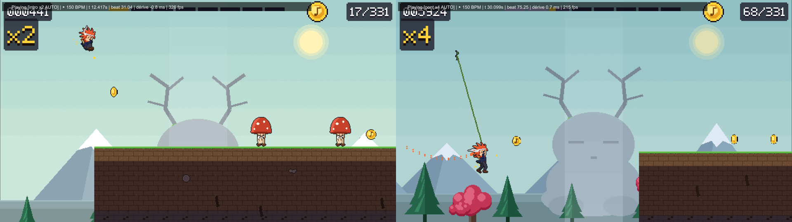
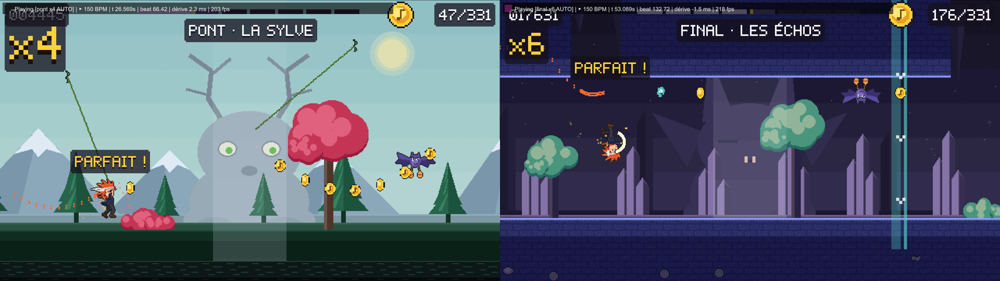
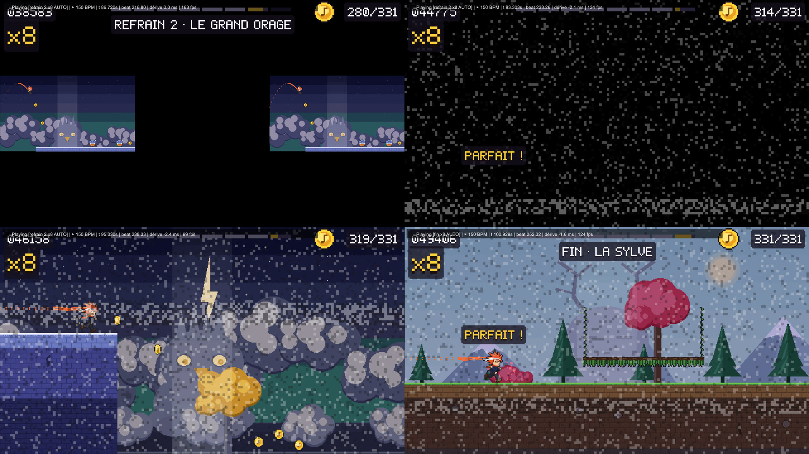
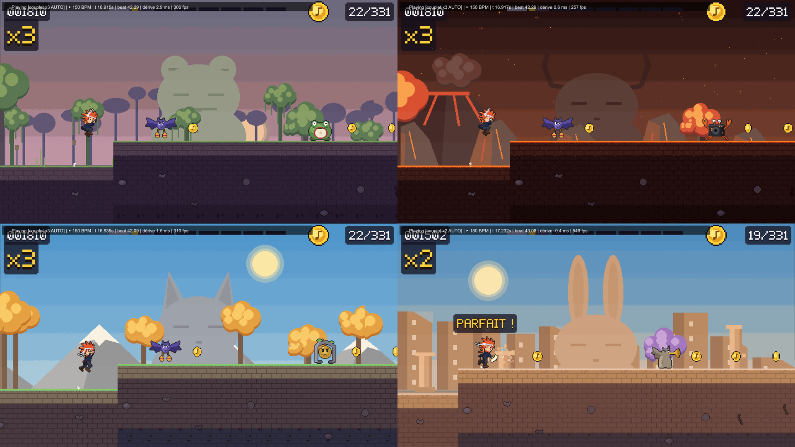

# Grand audit — verticalité, visuels et jeu (2026-11-25, après la PR #16)

Objectif : faire de Kenta un vrai « niveau musical » à la Rayman, **parfait à l'écran de la borne**. Cet audit repart du `main` du 25/11 (audit visuel terminé, obstacles Gemini de Lou intégrés). Il ne liste pas les petits défauts déjà connus : il dit ce qu'il faut **changer en profondeur**. Les points sont repris dans la [roadmap](roadmap.md#grand-audit-du-2026-11-25).

## Méthode
- Partie complète du niveau en **autoplay**, dans l'éditeur, Game view **1920×1080** : 213 captures (une toutes les 0,5 s). Niveau fini, S+, 331/331 pièces, 139 PARFAIT.
- Puis les **8 mondes**, 30 s chacun (472 captures).
- Les captures sont maintenant lues en fin d'image et encodées sur un autre thread : l'autoplay ne rate plus de saut pendant l'enregistrement (outil local `AuditCapture`).
- Chart lue avec `tools/gen-level-vertical.py --table`.
- **Limites.** L'autoplay joue parfaitement : le ressenti au joystick (tolérances, latence) n'est pas jugé ici. Rien n'a été testé sur la borne : Firefox ESR, GPU intégré, distance de 2 m.

**Corrigé pendant l'audit.** La brume du décor (P1 du dernier audit) ne couvrait qu'une **colonne de 282 px au centre de l'écran** : le sprite fait 1 × 8 px, et l'échelle ne tenait pas compte de sa largeur (`BiomeBackdrop`). La brume couvre maintenant toute la vue (image 8).

## État au 2026-11-25 (fin de journée, branche `feat/grand-audit`)

**Second passage, après la fusion de main** (PR #17 à #22 de Lou : ennemis visibles à l'avance, cuirassés, notes de saut, gardiens Gemini derrière les montagnes, manettes de la borne, sans glissade, miroir et écran retourné).
- Partie complète en autoplay, en 1920×1080 : niveau fini, note S.
- Nouveaux constats :
  - autoplay du jeu à **364 pièces sur 387** alors que le simulateur les prend toutes (déjà vrai sur main, à creuser) ;
  - **écran gris** quand la caméra change de zoom pendant l'écran dédoublé (corrigé) ;
  - deux **images de neige noire** (pont 2, FIN) et le **flash blanc** du final, toujours là (corrigés).

**Décisions de Jeremy**
- Un seul niveau assumé : le décor choisi est gardé tout le morceau, « DÉCOR » au lieu de « MONDE ». Cela pourra changer plus tard.
- Vue 480 par défaut.
- La musique sera fournie par l'équipe.

**Fait**
| Point | Ce qui a changé |
|---|---|
| B1 héros trop petit | Vue **480 (×4)** par défaut ; plans larges **640** posés par le générateur (`zoom_plan`) sur les tambours, les dénivelés de plus de 5,5 u en ±2 temps et les ennemis qu'on ne verrait pas venir. 43 % du morceau en plan large, surtout les refrains. Coupes nettes sur le temps, sans flash. |
| A4 caméra | Rail calculé avec la hauteur de vue de chaque tronçon ; cadrage selon la pente sur 2 temps (sol à 24 % du bas en montée, jusqu'à 56 % en descente). |
| A1 mur de terre | Sous 3,2 u, la profondeur des piliers s'efface par paliers (78, 56, 36, 20 %) : les grands piliers deviennent des îlots et l'on voit le paysage dessous. |
| A2 altitude | Les calques du décor descendent avec l'altitude (proche jusqu'à 6 u, milieu 3,5 u, loin 1,5 u) ; **mer de nuages** au bas de l'image à partir de 6 u ; ciel plus froid en hauteur. Le gardien reste immobile (choix de Lou, ADR-028). |
| C2 lianes | Corde de 4 px à contour sombre, feuilles en quinconce, nœud d'accroche de 8 px. |
| C3 portail | Vraie porte : montants et linteaux à contour, voile rayé, grosses flèches. |
| C4 plateformes | Dessous en îlot (deux paliers de terre en retrait, 14 px). |
| D1 refrain 2 | 2×2 au plus (×2 exact en vue 480) ; plus aucune image masquée ; neige à 30 % au plus, avec une zone dégagée autour du héros ; plus de grésillement sur la FIN ; les copies suivent les changements de zoom. |
| D2 télégraphie | Une mesure avant chaque surprise, annonce en or qui clignote en haut de l'écran (« ▲ LE MONDE SE RETOURNE », « ► VERS L'ARRIÈRE-PLAN », « LIANES : SAUTE POUR LÂCHER », « L'ÉCRAN SE DÉDOUBLE ! », et pour l'écran en miroir ou retourné de Lou). |
| D4 flash | Flash plein écran plafonné à 50 % (`ScreenFx`). |
| E1 mondes | Décor choisi gardé tout le morceau (`LevelBuilder.BiomeAt`), « DÉCOR » dans le choix et en fin de partie. |
| E5 héros | Un son de frappe par héros (`gen-sfx.py`) : caisse claire (Kenta), flûte (Aiko), basse (Ryo). |
| F interface | Frise du HUD calée sur les sections (largeur proportionnelle) ; l'intitulé ne nomme le décor qu'au départ. |
| G | Décor recalé au lancement de chaque partie, même enchaînée sur la démo. |

**Reste à faire**
- **E2 musique** et **E3 boucle REMIX** : il faut d'abord le morceau de l'équipe.
- **A3 gestes de montée et de descente** et **E4 contretemps, deux chemins** : à écrire sur la nouvelle musique.
- **D3 arrière-plan** : l'image du héros se règle dans `PlayerController`, que je ne modifie pas. L'annonce aide déjà.
- **B2 couleurs** (contour du héros, règles de couleur dans la DA), **A5 tuiles de pente**, **C5 sprites Gemini à refaire** (Lou), **C6 motifs du calque proche**.
- **Pièces** ratées par l'autoplay du jeu (372/395) alors que le simulateur les prend toutes : presque toutes dans les tambours du refrain 2 (beats 225 à 234).
- **Test sur la borne.**

---

## En bref : les 6 chantiers qui changeraient tout
1. **La verticalité ne se voit pas.** On monte de 54 u, mais rien dans l'image ne dit « je suis haut » : le décor reste le même et la terre remplit l'écran. → décor qui change avec l'altitude, terrain qui s'allège en hauteur (A1 à A3).
2. **Les 8 mondes sont le même niveau.** Même chart, mêmes obstacles aux mêmes temps, et l'Orage et les Échos reviennent dans tous les mondes. Choisir un monde ne change que la peau. (E1)
3. **Le héros est trop petit** pour une borne vue à 2 m : ~60 px sur 1080 en vue 640. (B1)
4. **Le « refrain détraqué » casse la lisibilité** : 5 écrans de 1/9 de la taille, une image entièrement brouillée, puis un grésillement qui déborde sur la fin. (D1, D2)
5. **Les gestes verticaux ne se lisent pas** : lianes de 1 px, portail de gravité en deux traits, plateformes en lignes, plafond fin. (C2 à C4)
6. **La musique est protégée** (Shovel Knight, ADR-014) et le niveau a été écrit pour elle. Tout le level design devra être refait sur la vraie musique : mieux vaut le savoir avant de polir la chart. (E2)

---

## A. Verticalité : le cœur du problème

### A1. P0 — Le niveau est une montagne de terre

**Constat**
- Sur les paliers hauts, **la moitié basse de l'écran est un aplat de terre brune** (Sylve), ou de briques bleues (Orage).
- Les piliers `Ground/Deep` font de **20 à 60 u de haut**. Le niveau monte en continu, de 0 à 54,5 u, en 44 marches et 8 rampes.
- Le joueur voit un mur sombre, pas une ascension. Les grandes rampes sont des escaliers de colonnes de 8 px, sans relief ni détail.

**Pistes**
- **Terrain en couches** : herbe, puis terre claire sur 1 à 2 u, puis une roche de plus en plus sombre et **plus transparente vers le bas**, qui se fond dans le fond du biome. On voit alors le paysage sous le palier.
- **Paliers flottants** au lieu de colonnes pleines : îles, ponts, branches, échafaudages selon le biome. Le vide sous le palier montre l'altitude.
- Détails de surface tous les 2 à 4 u (racines, cristaux, glaçons, briques cassées) pour que la pente défile.

### A2. P0 — Le décor ne réagit pas à l'altitude
**Constat**
- À 0 u comme à 50 u : même ciel, même gardien au même endroit, mêmes montagnes.
- Comme `BiomeBackdrop` pose les calques sur le sol le plus bas de la vue, **les arbres disparaissent derrière la terre** dès qu'on est en hauteur. Il ne reste que du ciel vide au-dessus du héros (image 1, Sylve).

**Pistes (façon Rayman Legends)**
- **Bandes d'altitude** : au-delà d'un seuil (par exemple +10 u), le calque proche est remplacé par une **mer de nuages** ou une forêt vue d'en haut. Au-delà de +25 u, ciel plus sombre et étoiles, et le gardien passe *sous* le héros. Il suffit de 2 à 3 bandes par biome, en fondu.
- **Parallaxe verticale** : les calques lointains descendent un peu quand on monte (aujourd'hui `groundFollow` = 0,35 / 0,7 / 1, mais seulement pour se poser sur le sol).
- **Le gardien regarde le héros** : ses yeux suivent la hauteur. Ça coûte peu et ça donne une échelle.

### A3. P1 — Monter et descendre doit être un moment musical, pas un escalier
**Constat (`--table`)**
- La verticalité, c'est surtout **44 marches** à sauter, presque toutes du même gabarit, et des rampes longues et régulières.
- Les couplets 1 et 2 ont **le même tracé**.
- Les descentes sont de longues rampes à 45° où il ne se passe rien (images 2).

**Pistes** (voir [level-design-musical.md](level-design-musical.md#3-la-verticalité-a-un-sens))
- Varier les gestes de montée :
  - marche simple ;
  - **double marche sur une croche** ;
  - **mur à grimper** sur une note tenue (le `wall` existe, il n'est utilisé que 3 fois) ;
  - **tambours en chaîne** ;
  - **plateformes qui montent sur le temps**.
- Varier les descentes : **dévalée avec ennemis à frapper en glissant**, **saut dans le vide avec pièces en colonne**, **descente en zigzag de plateformes**.
- Une **seule grande ascension par section**, avec un sommet visible (drapeau, gardien, point de vue), plutôt qu'une montée continue.

### A4. P1 — La caméra perd le sol en descente et le héros sur les tambours
 

**Constat**
- **En descente**, le héros est collé en bas à gauche, avec 70 % de ciel vide au-dessus. On ne voit pas où l'on va (Orage, beat ~120).
- **Sur les tambours**, le héros touche le haut de l'image et le sol d'arrivée est hors champ (beats ~30 et ~70).
- La vue fait 9 u de haut : une chute de plus de 6 u se fait à l'aveugle (point P1 existant).

**Pistes**
- **Rail de caméra asymétrique** : en descente, cadrer le héros au tiers *haut* pour montrer la pente devant. En montée, l'inverse. Le rail est déjà précalculé par `gen-level-vertical.py` : y ajouter la pente du terrain sur 1 à 2 mesures devant.
- **Dézoom ponctuel** de 480 à 640 sur les tambours et les grands plongeons, posé par la chart (`camera`), rezoom à l'atterrissage. Cela suppose une vue 480 par défaut (B1).
- **Repère d'arrivée** quand le sol est hors champ : flèche ou ombre du héros au bord bas de l'écran.

### A5. P2 — Les rampes en escalier se lisent mal
Les rampes sont des colonnes de 8 px. Le héros glisse sur la pente exacte, mais l'image montre des marches. Pour une rampe lisible, dessiner des **tuiles de pente** à 1:1 et 1:2 par biome (le pixel art sans rotation le permet : ce sont des tuiles, pas des sprites tournés).

---

## B. Lisibilité à la borne

### B1. P0 — Héros trop petit
**Constat**
- En vue 640 (×3), le héros fait ~20 px de jeu, soit **~60 px sur 1080 (5,5 % de la hauteur)**. Les ennemis et les pièces sont encore plus petits.
- À 2 m, sur la borne, c'est une tache. Dans Rayman Legends, le héros fait 12 à 15 % de la hauteur.

**Pistes**
- Vue **480 (×4) par défaut**. Garder 640 seulement pour les tambours et les plongeons (A4), en plans posés par la chart.
- Contour sombre de 1 px autour du héros (il disparaît sur l'Orage et les Échos).

### B2. P1 — Trop de choses de la même couleur que le décor
- Échos et Orage : le héros bleu-noir se perd sur les fonds bleu-violet.
- Les ennemis violets (chauves-souris) se perdent sur les Échos.
- Les pièces jaunes se perdent sur les arbres jaunes de l'Échine et de l'Orage.
- **Règle à fixer dans la DA** : le décor n'utilise jamais la couleur des pièces ni celle du bandeau. Le premier plan jouable est plus contrasté que tout le fond, ce qui veut dire baisser la saturation et le contraste des calques de fond.

### B3. P1 — Le décor proche se met devant l'action
Grands arbres roses (Sylve), arbres jaunes (Orage) : le calque proche passe parfois **devant les ennemis et les pièces** à la même hauteur (images 7, 8). Il faut le garder **sous la ligne de sol**, ou le pâlir quand un objet jouable est devant.

---

## C. Visuels (après les obstacles de Lou)

### C1. Ce qui marche
- Les obstacles Gemini de Lou donnent du volume. Les plafonds de glissade (cristaux des Échos, glaçons du Givre) et la plateforme suspendue de l'Orage sont réussis.
- Les gardiens sont lisibles et forts.

### C2. P1 — Lianes invisibles

Une liane est un **trait vert de 1 px** en diagonale : on ne voit ni la corde, ni le point d'accroche, ni le moment du lâcher. Il faut :
- une corde de 2 à 3 px, avec des feuilles ;
- un nœud d'accroche dessiné (déjà en P1 dans la roadmap) ;
- un **halo sur le temps du lâcher**, pour qu'on lâche sur le rythme.

### C3. P1 — Portail de gravité et plafond peu lisibles
- Le portail est deux colonnes cyan avec trois chevrons : on dirait un bug d'affichage.
- Pendant la course au plafond (Échos), le plafond n'est qu'une bande sombre ; on ne comprend pas que le haut est devenu le bas.
- **Piste** : un vrai sprite de portail (arche, tourbillon), l'écran qui pivote visuellement d'un cran (flash plus inversion des calques de fond), et un plafond dessiné comme un sol, herbe vers le bas.

### C4. P1 — Plateformes et barres de glissade encore fines
- Les plateformes flottantes du pont 2 se lisent comme des **lignes de 2 px** (point P2 existant, à remonter en P1).
- Les poteaux de barre font 8 × 16 px : on voit mal la barre sous laquelle glisser.

### C5. P2 — À refaire dans Gemini (noté par Lou)
`wall_orage` (socle plat), `block_orage` et `post_orage` (contours hachés), `block_cite` (trop proche de l'ancien), `post_echine` (corde en rayures). Aussi : **un poteau planté au pied d'une falaise** (Sylve, beat ~28 : image 7, en haut à gauche), à vérifier dans la chart.

### C6. P2 — Le calque proche est encore répétitif
Même arbre rose toutes les 2 secondes : 5 motifs ne suffisent pas à 8 u/s. Il faudrait 8 à 10 motifs, ou des motifs **par section** (couplet : forêt dense ; pont : roseaux ; refrain : rien, ciel ouvert).

---

## D. « Le niveau qui change » (travail de Lucas)

### D1. P0 — Le refrain 2 détraqué est illisible sur la borne

**Constat**
- **5 écrans de 640×360** sur fond noir : le héros fait ~15 px. À 2 m, on ne le voit plus.
- Une image entière de **neige** sans aucun jeu visible (beat ~233).
- Puis un **second grésillement couvre la section FIN** (beats 248 à 254, en bas à droite). Il est voulu (`glitch` au beat 248 dans la chart), mais il gâche la sortie : la fin devrait être le moment calme et net où l'on savoure le score.

**Pistes**
- 2 écrans au maximum (côte à côte, ×3), jamais 5 ni 9.
- Neige à 30 % d'opacité au plus, et **jamais sur le héros** (masque autour de lui).
- Retirer le `glitch` du beat 248 (ou le limiter à une mesure, à 20 %).

### D2. P1 — Les surprises ne s'annoncent pas
Le portail, le passage à l'arrière-plan et le split arrivent sans prévenir. La règle du doc (« la surprise s'annonce une mesure avant ») n'est pas visible à l'écran. Le jeu a besoin d'une **télégraphie** : icône, son, flash du HUD une mesure avant (point P1 de la roadmap, à faire en premier).

### D3. P1 — L'arrière-plan (`back`) ne se voit pas
Le héros qui court derrière les piliers est simplement assombri. On ne comprend pas qu'il a changé de plan. Pistes :
- **héros plus petit d'un cran** (sprite réduit dessiné, pas une échelle fractionnaire) ;
- premier plan qui passe en silhouette ;
- son étouffé.

### D4. P2 — Le flash du final est trop fort
L'entrée dans le final (beat ~128) blanchit **tout l'écran** (capture `w1_0101`). Il faut éviter les flashs plein écran à 100 % (photosensibilité sur une borne publique) : 50 % au plus, et pas plus de 3 flashs par seconde.

---

## E. Contenu, rejouabilité, arcade

### E1. P0 — 8 mondes, 1 seul niveau

**Constat**
- Les 8 `Level_0x_*.asset` pointent sur **la même musique et la même chart** (`chart: {fileID: 0}`). Seul le biome change, et seulement pour une partie du morceau : le refrain passe toujours dans l'Orage, le final dans les Échos.
- Même score à la seconde près dans les 8 mondes. Choisir un monde est donc trompeur.

**Pistes (au choix, à décider en équipe)**
- **a.** Garder **1 niveau soigné** et faire du choix du monde un choix cosmétique assumé : « décor ». Retirer « MONDE 1/8 » de l'écran de choix.
- **b.** **3 niveaux** (facile, moyen, difficile) sur 3 morceaux, chacun dans 2 à 3 biomes. C'est la vraie difficulté croissante demandée par le sujet.
- **c.** Une chart par monde générée par variation : mêmes sections, obstacles remélangés, `gen-level-vertical.py` avec une graine.

### E2. P0 — Musique : à remplacer avant de finir le level design
« Main Theme » de Shovel Knight est protégé (ADR-014) : il est interdit sur la borne publique comme sur le site. La chart entière (sections, accents, 331 pièces) est écrite sur cette musique. **Plus on polit la chart, plus le changement coûtera cher.**
- Choisir le morceau final **maintenant** (original ou CC-BY, 140 à 160 BPM, sections nettes).
- Écrire ensuite les scènes de `gen-level-vertical.py` dessus.

### E3. P0 — Pas de difficulté croissante ni de fin arcade
- La partie dure 103 s puis s'arrête. Le sujet impose une difficulté croissante.
- La boucle REMIX 8-bit (point P0 existant) est la bonne réponse : la reprioriser au-dessus du polish.

### E4. P1 — Le jeu se joue presque tout seul
L'autoplay fait 139 PARFAIT et 0 BIEN : les actions tombent toutes sur des temps forts évidents. Il manque :
- des **contretemps** et des **doubles croches** (deux frappes rapides) ;
- des choix : un chemin haut avec plus de pièces mais plus dur, contre un chemin bas sûr. **Deux chemins** sur quelques passages donneraient enfin une raison de rejouer pour le score.

### E5. P1 — Les 3 héros sont identiques
Point existant, à remonter : il faut au moins un son de frappe par héros, et idéalement un petit avantage (saut plus haut, glissade plus longue, frappe plus large).

---

## F. Interface et écrans
- **P1** Le HUD ne montre pas **où l'on en est dans le morceau**. La frise a 8 segments, alors qu'il en faut 11 sections (point existant) : la remplacer par une barre de progression avec les sections.
- **P2** « BRAVO ! » : le panneau cache le héros, qui est en bas à gauche. Faire une pose de victoire au centre, et un vrai feu d'artifice (point existant).
- **P2** Les étiquettes de section (« REFRAIN · LE GRAND ORAGE ») apparaissent même quand le monde ne change pas. Ne nommer le biome que s'il change.

## G. Technique
- **Corrigé** : brume en colonne (voir en tête).
- **P1 — à vérifier** : passer directement de la démo de l'accueil à une partie, sans écran de fin, ne remet pas le décor à zéro. Le décor glisse pendant 0,6 s depuis la hauteur de la démo : vu en enchaînant les mondes avec l'outil d'audit. Il suffirait de remettre `BiomeBackdrop.groundValid` à faux au lancement d'une partie.
- **P1** `test_generated_chart_is_feasible_and_vertical` échoue toujours : il teste l'ancien générateur. Il faut un vrai test du nouveau (la chart est faisable, avec 120 ms de marge partout).
- **P0** Les performances sur la borne sont inconnues : 330 pièces, 3 calques, la neige plein écran et le split en 5 copies d'image sont à mesurer sur un GPU intégré dans Firefox.

---

## Ordre conseillé
1. **Décisions d'équipe (1 réunion)** : la musique finale (E2), « 1 niveau ou 3 » (E1), la vue par défaut à 480 (B1).
2. **Lisibilité** : héros plus grand (B1), refrain 2 lisible (D1), lianes, portail et plateformes (C2 à C4), télégraphie (D2).
3. **Verticalité visible** : terrain en couches (A1), bandes d'altitude (A2), caméra en descente et sur les tambours (A4).
4. **Level design sur la vraie musique** : gestes de montée et de descente variés (A3), contretemps et deux chemins (E4), boucle REMIX (E3).
5. **Polish** : C5, C6, F, D4, puis **test sur la borne**.
